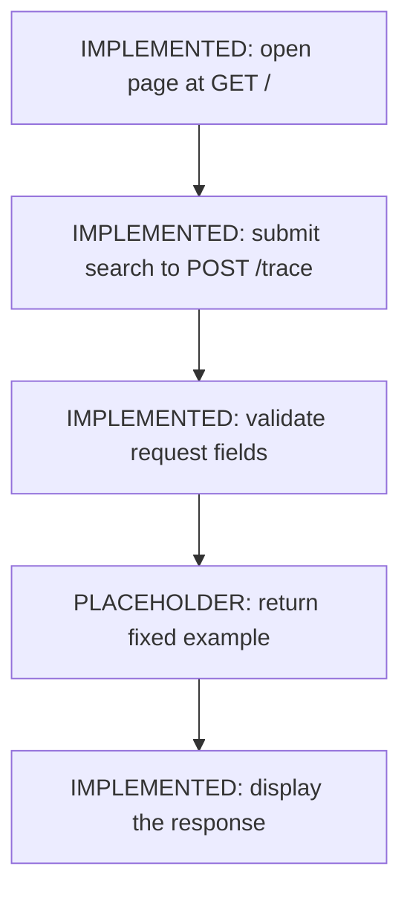
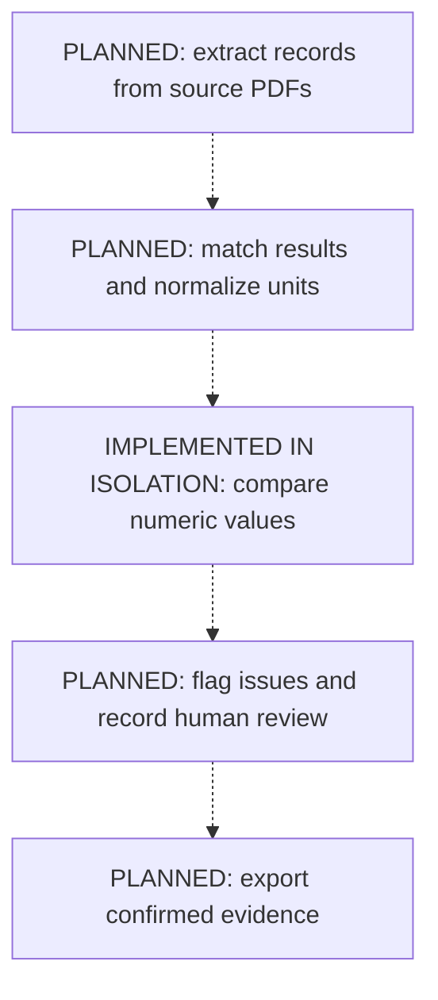

# Project map

Drinking Water Evidence Tracer aims to help researchers trace Zone I1 drinking water
results to the laboratory and review pages behind them. The [proposal](proposal.md)
defines the intended product; this map describes the code that exists today.

## What works today

- **Implemented:** a page, JSON request/response models (definitions of the fields
  exchanged with the page), and a numeric disagreement rule tested on its own.
- **Placeholder:** every valid search returns the same HT03 lead example. The
  displayed flags, source preview, and inventory are fixed demonstration content.
- **Planned:** reading PDFs, model extraction, record matching, unit conversion,
  applying real flags, human-review actions, storage, and evidence export.

## Current processing



The form sends the sample ID and analyte as JSON (structured text). The route checks
the request's field types, builds a response using the declared models, and sends it
back to the page. Search values do not select or process real evidence yet.

### The separate numeric rule

[`result_values_disagree`](../app/rules.py) compares two `Decimal` numbers: an
extracted value and the corresponding value on the same report's Detection Summary.
The caller must first establish that they refer to the same result in the same units.

| Input pair | Output | Meaning |
| --- | --- | --- |
| `13.7`, `3.7` | `True` | Values disagree. |
| `3.7`, `3.70` | `False` | Values are equal despite the trailing zero. |

Both examples are checked in [tests/test_rules.py](../tests/test_rules.py).
The page does not call this function. It does not match samples, convert units,
round values, confirm a result, or enforce inventory/export restrictions.
The report's Detection Summary is distinct from the Navy's combined summary table.

## Intended processing and remaining work



All connections in this second diagram are **planned**. In the intended workflow,
disagreements keep results unconfirmed for review; equality alone does not confirm
them. Other proposal rules will also be needed. The next integration must supply
matched values and apply the comparison outcome to review status. See proposal
sections [10-11](proposal.md#10-llm-role), [14](proposal.md#14-human-review), and
[15-16](proposal.md#15-one-failure-case) for the requirements.

## Where to find things

| File | Responsibility |
| --- | --- |
| [app/main.py](../app/main.py) | Web entry point: page, browser script, routes, and fixed response. |
| [app/agent.py](../app/agent.py) | Input/output field models; no agent or model call is initialized. |
| [app/rules.py](../app/rules.py) | Plain-Python evidence decisions; currently one numeric comparison. |
| [tests/test_skeleton.py](../tests/test_skeleton.py) | Page/form and endpoint field checks; real model requests are blocked. |
| [tests/test_rules.py](../tests/test_rules.py) | Numeric mismatch and equality examples. |
| [.github/workflows/tests.yml](../.github/workflows/tests.yml) | Installs locked dependencies and runs lint, type checks, and tests in CI. |
| [pyproject.toml](../pyproject.toml) / [uv.lock](../uv.lock) | Dependency declarations, locked versions, and check configuration. |
| [AGENTS.md](../AGENTS.md) / [CLAUDE.md](../CLAUDE.md) | Shared contributor instructions; CLAUDE.md points to AGENTS.md. |

The root [main.py](../main.py) is the original greeting script. Start the web
application with `app/main.py` as shown below.

## Run and verify

With [uv installed](https://docs.astral.sh/uv/getting-started/installation/), run
these commands from the repository root. Python 3.14 is selected by
[.python-version](../.python-version); the exact patch version can vary.

```bash
uv sync --locked --dev
uv run fastapi dev app/main.py
```

Open the local URL printed by the server and submit the form to see the fixed
example. The server stays running until stopped with Ctrl+C. Run checks in another
terminal, or stop the server first:

```bash
uv run ruff check
uv run mypy
uv run pytest
```

Ruff checks code quality; mypy checks declared types (currently scoped to `app/`);
pytest runs behavior checks. CI runs the same three commands. The current tests
run without real model calls. The current app needs no API credentials or PDF data.
`--locked` makes dependency setup fail if the lockfile needs updating, rather than
silently changing it. See [uv's sync documentation](https://docs.astral.sh/uv/concepts/projects/sync/).

For future extraction, record source versions, prompt/model versions, settings,
outputs, and reviewer corrections to make results traceable. Model reruns may vary.
Keep secrets in the environment or ignored `.env` file, as required by AGENTS.md.

## Decision record

Keep only significant, lasting choices here. Future entries should state the reason,
alternatives actually considered, consequences, and a supporting PR. These existing
choices are documented in the proposal and merged PRs:

| Choice and reason | Consequence | Evidence |
| --- | --- | --- |
| Keep domain decisions in plain Python, separate from model extraction, so tests can check them exactly. | The caller must handle extraction, matching, and applying decisions. | Proposal section 10; [first rule PR](https://github.com/alemarieceria/drinking-water-evidence-tracer/pull/3). |
| Start with a fixed response to establish the page and data shapes. | Displayed data is illustrative until real processing is connected. | [Skeleton commit](https://github.com/alemarieceria/drinking-water-evidence-tracer/commit/653447a). |

Update this map when capabilities, connections, setup, or responsibilities change.
Keep detailed requirements in the proposal and change-specific reasoning in PRs.
