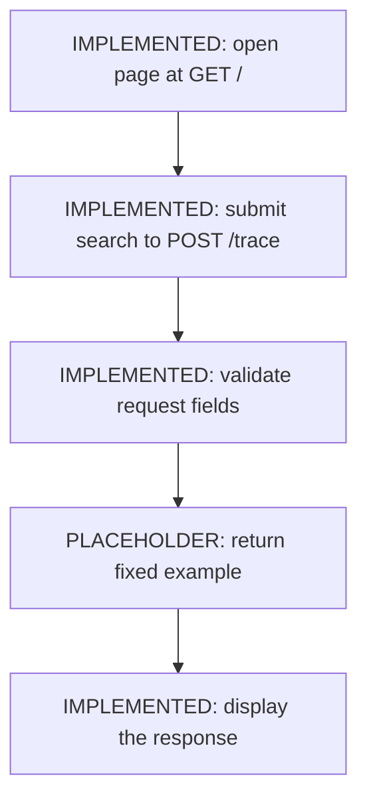
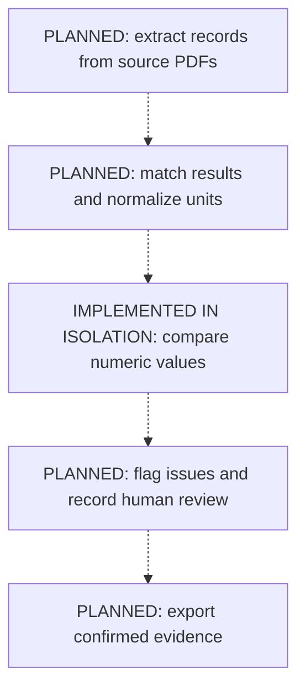

# Project map

Drinking Water Evidence Tracer aims to help researchers trace Zone I1 drinking water
results to the laboratory and review pages behind them. The [proposal](proposal.md)
defines the intended product; this map describes the code that exists today.

## What works today

- **Implemented:** `/extract` selects an archived document and two PDF pages,
  checks the PDF fingerprint before/after reading, and uses the pinned text reader.
- **Implemented:** bounded model extraction, source-line checks, raw field
  preservation, nondetect interpretation, and unconfirmed row inspection.
- **Implemented:** atomic local JSON run records and an explicitly invoked live
  scorer that requires reviewed, unchanged fixtures. All pytest model calls are blocked.
- **Placeholder:** `/` and `/trace` still show the fixed HT03 lead demonstration.
- **Planned:** full-corpus processing, matching, unit conversion, real discrepancy
  flags, human confirmation/correction, inventory integration, and evidence export.

The [design](superpowers/specs/2026-10-29-page-extraction-design.md) and
[implementation plan](superpowers/plans/2026-11-05-page-extraction.md) define this
experiment; proposal sections 10 and 19 define its scope. The two expected-row
references were checked by A. Ceria; they cover captured environmental fields,
not every report column or QC row. Live trial results belong in the feature PR,
not a claim of accuracy across all five intended laboratory formats.

DOM tests check state handling and text rendering. The owner reports manual Tab
traversal and supplied screenshots at 100% and 200% zoom. Keyboard activation,
complete zoom/reflow behavior, and screen-reader checks remain pending.
No accessibility-conformance claim is made.

## Current processing



The form sends the sample ID and analyte as JSON (structured text). The route checks
the request's field types, builds a response using the declared models, and sends it
back to the page. Search values do not select or process real evidence yet.

### Separate extraction experiment

At `/extract`, the researcher enters doc_id, results PDF page, and definitions
PDF page. POST /extract creates a running record, reads fingerprint-checked text,
checks the input limit, and calls the configured model. Python validates source
references and interprets raw results. A usable response is saved and displayed
as unconfirmed rows in source order, beside the text. Errors and unclear output
return no rows; storage failure never presents success. Input changes and new
submissions clear old output, and late responses cannot replace a newer request.
A successful request does not establish completeness or field accuracy.

### The separate numeric rule

[`result_values_disagree`](../app/rules.py) compares two `Decimal` numbers: an
extracted value and the corresponding value on the same report's Detection Summary.
The caller must first establish that they refer to the same result in the same units.

| Input pair | Output | Meaning |
| --- | --- | --- |
| `13.7`, `3.7` | `True` | Values disagree. |
| `3.7`, `3.70` | `False` | Values are equal despite the trailing zero. |

Both examples are checked in [tests/test_rules.py](../tests/test_rules.py).
The page does not call this function. It does not match samples, convert units,
round values, confirm a result, or enforce inventory/export restrictions.
The report's Detection Summary is distinct from the Navy's combined summary table.

### Finding source PDFs

The PDFs are not stored in this repository. They live in the project's document
archive (a Google Shared Drive), whose catalog, `registry/documents.csv`, has one row
per file with its location and SHA-256 fingerprint (a code that changes if any byte
of the file changes). [`app/archive.py`](../app/archive.py) reads that catalog:

1. `ARCHIVE_ROOT` in `.env` names the archive folder.
2. [`data/v1_documents.txt`](../data/v1_documents.txt) lists the version 1 set by
   catalog ID, for example `DOC-0010`, the Level 4 lab report pub_002925.
3. The catalog lookup keeps only downloaded files and skips rows whose
   `duplicate_of` column is filled, so a duplicate upload is never processed twice.
4. The check recomputes each fingerprint and reports missing or changed files.

`uv run python -m app.archive` runs these steps for the version 1 set and prints
`27 documents found in ...; all files present and unchanged.` or a list of problems.
The separate page reader can read selected PDF pages; the current demonstration
route does not use it.

## Intended processing and remaining work



All connections in this second diagram are **planned**. In the intended workflow,
disagreements keep results unconfirmed for review; equality alone does not confirm
them. Other proposal rules will also be needed. The next integration must supply
matched values and apply the comparison outcome to review status. See proposal
sections [10-11](proposal.md#10-llm-role), [14](proposal.md#14-human-review), and
[15-16](proposal.md#15-one-failure-case) for the requirements.

## Where to find things

| File | Responsibility |
| --- | --- |
| [app/main.py](../app/main.py) | Web entry point: page, browser script, routes, and fixed response. |
| [app/extraction_page.html](../app/extraction_page.html) / [app/static/extraction.js](../app/static/extraction.js) | Separate extraction page, plain-text rendering, row details, and stale-response protection. |
| [app/agent.py](../app/agent.py) | Bounded model extraction and captured messages; initialized only for an extraction request. |
| [app/models.py](../app/models.py) | Shared data contracts; raw numeric strings and unconfirmed review status. |
| [app/rules.py](../app/rules.py) | Numeric disagreement, detection/nondetect interpretation, and source-reference checks. |
| [app/archive.py](../app/archive.py) | Finds source PDFs through the archive catalog and checks their fingerprints. |
| [app/pages.py](../app/pages.py) | Reads the selected pages, preserving text and checking the fingerprint before and after reading. |
| [app/extraction.py](../app/extraction.py) / [app/runs.py](../app/runs.py) | Orchestrates extraction and preserves versioned local run JSON, respectively. |
| [tests/fixtures/extraction/](../tests/fixtures/extraction/) | Stored page text, reader settings and hashes, and reviewed expected rows for the two development inputs. |
| [data/v1_documents.txt](../data/v1_documents.txt) | Catalog IDs of the 27 version 1 PDFs, grouped by batch. |
| [tests/test_skeleton.py](../tests/test_skeleton.py) | Page/form and endpoint field checks; real model requests are blocked. |
| [tests/test_rules.py](../tests/test_rules.py) | Numeric mismatch and equality examples. |
| [tests/test_archive.py](../tests/test_archive.py) | Catalog lookups against a temporary catalog; needs no Shared Drive. |
| [.env.example](../.env.example) | Names the settings `.env` needs, without real values. |
| [.github/workflows/tests.yml](../.github/workflows/tests.yml) | Installs locked dependencies and runs lint, type checks, and tests in CI. |
| [pyproject.toml](../pyproject.toml) / [uv.lock](../uv.lock) | Dependency declarations, locked versions, and check configuration. |
| [AGENTS.md](../AGENTS.md) / [CLAUDE.md](../CLAUDE.md) | Shared contributor instructions; CLAUDE.md points to AGENTS.md. |
| [.agents/skills/](../.agents/skills/README.md) | Implemented: 15 upstream Superpowers skills plus the project-owned [evidence-review](../.agents/skills/evidence-review/SKILL.md) for read-only PR claim review. These guide coding agents; they are not application processing. Upstream revision and license are recorded in the skills overview. |
| [docs/assets/proposal/](assets/proposal/) / [docs/assets/project/](assets/project/) | Proposal and system visuals with their editable sources. The extraction design's flow is explicitly planned; local trials stay outside the repository. |

The root [main.py](../main.py) is the original greeting script. Start the web
application with `app/main.py` as shown below.

## Run and verify

With [uv installed](https://docs.astral.sh/uv/getting-started/installation/), run
these commands from the repository root. Python 3.14 is selected by
[.python-version](../.python-version); the exact patch version can vary.

```bash
uv sync --locked --dev
uv run fastapi dev app/main.py
```

Open the local URL printed by the server and submit the form to see the fixed
example. The server stays running until stopped with Ctrl+C. Run checks in another
terminal, or stop the server first:

```bash
uv run ruff check
uv run mypy
uv run pytest
```

Ruff checks code quality; mypy checks declared types (currently scoped to `app/`);
pytest runs behavior checks. CI runs the same three commands. The current tests
run without real model calls or the archive. The demonstration needs no credentials;
`/extract` also requires ARCHIVE_ROOT, LLM_API_GATEWAY (an HTTP(S) API base URL),
LLM_API_TOKEN, and an explicitly selected LLM_MODEL from the environment or local .env.
Optional LLM_REASONING_EFFORT is recorded when supplied; the chosen GPT-6 Luna
Chat baseline requires `none`. No model or reasoning choice is silently inferred.

Frontend state tests use Node 22+ and a locked, development-only jsdom dependency:
`npm ci --prefix tests/browser` then `npm test --prefix tests/browser`.
CI runs these tests too. They verify stale/error handling and text rendering;
they do not establish visual layout, keyboard, zoom, or screen-reader behavior.

To check the source PDFs, copy the `ARCHIVE_ROOT` line from
[.env.example](../.env.example) into `.env`, adjust the path if your Shared Drive
letter differs, and run:

```bash
uv run python -m app.archive
```
`--locked` makes dependency setup fail if the lockfile needs updating, rather than
silently changing it. See [uv's sync documentation](https://docs.astral.sh/uv/concepts/projects/sync/).

Extraction run files preserve source fingerprints, prompt/model identifiers,
settings, captured outputs, and failures in gitignored `runs/`. An interrupted
attempt remains marked running; it is not a success. Model reruns may vary.
Keep secrets in the environment or ignored `.env` file, as required by AGENTS.md.

## Live experiment

With source access and model configuration ready, run
`uv run python -m scripts.evaluate_extraction --live --fixture DOC-0033-p6`
and repeat with `DOC-0003-p7`. The explicit flag is required. The scorer verifies
review metadata, file hashes, PDF fingerprints, reader versions/options, and
regenerated text before making a model request. It compares the eleven CSV
fields exactly, matching sample/analyte/method plus occurrence; it reports missing
and extra rows separately and checks order. Different method spellings can
prevent a strict row match even if other values look correct. No overall passing
accuracy threshold is chosen. Scores link to their run and reference hash in
`runs/<uuid>.score.json`; source PDFs, tokens, and run artifacts are not committed.

## Decision record

Keep only significant, lasting choices here. Future entries should state the reason,
alternatives actually considered, consequences, and a supporting PR. These existing
choices are documented in the proposal and merged PRs:

| Choice and reason | Consequence | Evidence |
| --- | --- | --- |
| Keep domain decisions in plain Python, separate from model extraction, so tests can check them exactly. | The caller must handle extraction, matching, and applying decisions. | Proposal section 10; [first rule PR](https://github.com/alemarieceria/drinking-water-evidence-tracer/pull/3). |
| Start with a fixed response to establish the page and data shapes. | Displayed data is illustrative until real processing is connected. | [Skeleton commit](https://github.com/alemarieceria/drinking-water-evidence-tracer/commit/653447a). |
| Find source PDFs through the document archive's catalog, keeping one fingerprinted copy with its source and download time. The alternative considered was hand-copied PDFs in `data/reports/v1/`, which had no recorded source or fingerprint and duplicated the archive. | Checking real files needs the Shared Drive available; tests use a temporary catalog. The catalog's `duplicate_of` column decides which copy is processed. | [Archive catalog PR #12](https://github.com/alemarieceria/drinking-water-evidence-tracer/pull/12). |
| Use pdfplumber 0.11.10 layout mode with pdfminer.six 20260107 for extraction. It kept both fixture tables readable and retained the blank MDL. pypdf's tested modes lost or joined fields, PyMuPDF joined rows and has AGPL/commercial licensing, and Poppler needs a separate executable. | Reader installed and tested in isolation. Pin reader versions/settings; preserve margin tabs and investigate model accuracy separately. | [Library comparison and owner acceptance, PR #13](https://github.com/alemarieceria/drinking-water-evidence-tracer/pull/13); [design comparison](superpowers/specs/2026-10-29-page-extraction-design.md#pdf-library-comparison). |

Update this map when capabilities, connections, setup, or responsibilities change.
Keep detailed requirements in the proposal and change-specific reasoning in PRs.
