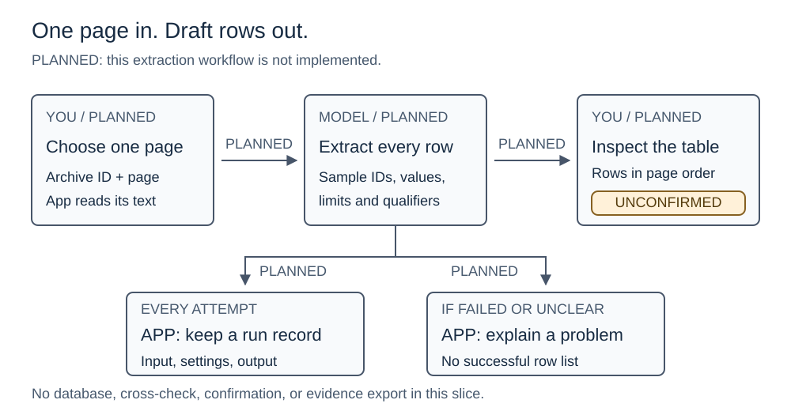

# One-page laboratory result extraction

**Proposed, not implemented.** Build a small page that sends supplied report text
to a model and shows draft results beside that text. The final layout can change.

## At a glance

*All steps and connections are planned. Unconfirmed means a person still needs
to check the result.* [Full-size diagram](../../assets/project/planned-page-extraction-flow.svg)
· [Editable source](../../assets/project/planned-page-extraction-flow.excalidraw)

**Text equivalent:** You supply page text and source details. The model extracts
environmental result rows. You inspect, search, filter, and sort the draft table.
The app keeps a local record of the attempt. If extraction fails or the page is
too unclear, it explains the problem without presenting a successful result list.

## What you will do

| Step | What happens |
| --- | --- |
| Supply a page | Open the extraction page. Paste one complete results page; enter its source ID, title, PDF page number, and any qualifier definitions. Other metadata is optional. |
| Extract | Select **Extract page**. The app sends the supplied content to the configured model and shows progress. |
| Inspect | See every returned environmental analyte row, including rows for different samples, beside the submitted text. Select a row for its limits, qualifier, sample IDs, and source excerpt. |
| Explore | Search row fields; combine sample, result-type, qualifier, and missing-field filters; click headings to sort. Reset restores source order. These controls make no new model calls. |

For example, the first sample page should return **21 analyte rows across three
samples**, excluding nine surrogate recovery rows. All results stay unconfirmed.

## Important boundaries

- Extract environmental analyte results, not QC measurements, surrogate recoveries,
  or headings. Keep each row attached to its own sample and supplied citation.
- Preserve result text, qualifiers, units, and decimal precision. Missing fields
  stay missing. A nondetect such as `<0.020` is not a measured value of `0.020`.
- Show the filtered count separately from total rows returned. “No rows match”
  must not imply “no detections.” Filtering and sorting do not alter the records.
- Numeric sorting compares measured concentrations within identical reported
  units; nondetects stay last in both directions. Do not convert units. Keep the
  selected row's details correct after sorting/filtering; hide them if no rows match.
- Clearly separated QC/surrogate sections can be excluded. If section boundaries
  are uncertain, report an unclear page instead of claiming a successful extraction.
- Errors preserve the user's input and never make old or partial output look
  current. A returned row count does not prove extraction is complete or correct.

## Choices proposed for your review

| Choice | Why |
| --- | --- |
| Separate extraction page; existing demo stays labeled | Makes the real experiment distinct from the fixed demonstration response. |
| Local run files, no database or history screen | Preserve source text, metadata, prompt/model/settings, outputs, and errors so attempts can be investigated after restart. These are not confirmed evidence sets. |
| Model extracts; Python interprets; people confirm later | Keep evidence rules separate from model calls and presentation. Pasted report content is data, not instructions. |
| Bounded requests; explicit server-side model configuration | Avoid unlimited retries and hidden model choices. Credentials never reach browser output or run records. |

Exact request limits, file formats, function names, and module splits belong in
the implementation plan. Document them there before building; update AGENTS.md
and the project map if responsibilities move. No particular model is selected yet.

**Out of scope:** PDF upload/viewing, RAG, a database, cross-checks, summary matching,
inventory updates, confirmation/correction, evidence export, and a full UI redesign.
No claim of extraction accuracy across all five laboratory formats is made.

## How we will check it

| Development input | What it checks |
| --- | --- |
| Archive `DOC-0033` (`pub_002948.pdf`, batch 810-12365-1), p. 6; definitions p. 3 | 21 rows, three sample identities, less-than values, separate limits, and exclusion of surrogate rows. |
| Stage 2 combined laboratory release, p. 7; definitions p. 16 | 35 rows with ordinary detections, J qualifiers, ND/U results, and a missing MDL that must not be invented. |

These are development fixtures only: neither expands the proposal's version-one
corpus. The Stage 2 example is also outside Zone I1. Preserve source versions and
hand-checked expectations with the fixtures; tests must not depend on a neighboring
checkout or on the Shared Drive archive.

Offline tests block real model requests and check field handling, sample boundaries,
table controls, failures, and local run records. Check keyboard use, focus, zoom,
narrow layouts, and screen-reader behavior. Run Ruff, mypy, and pytest. A separately
invoked live experiment can measure extraction accuracy once a model is configured;
offline tests alone cannot establish that accuracy.

## Why this approach, and what comes next

We chose **one-page extraction** to establish the page-to-model connection first.
Two-page cross-checking adds matching work; validation-narrative extraction tests
a different problem. Both remain later options.

After design review, write and review the implementation plan, then build and
verify the feature. The [proposal's sections 10 and 19](../../proposal.md#10-llm-role)
define the project scope; this document describes only this change.
